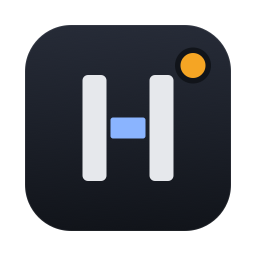
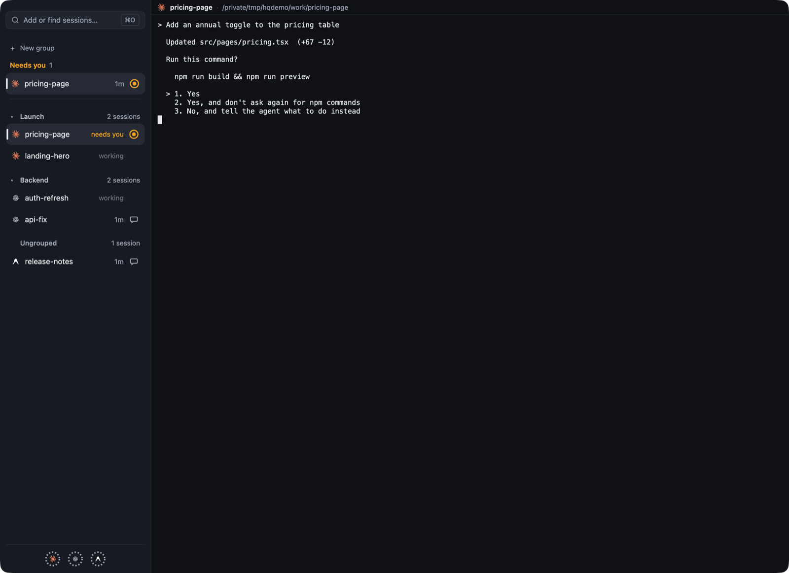
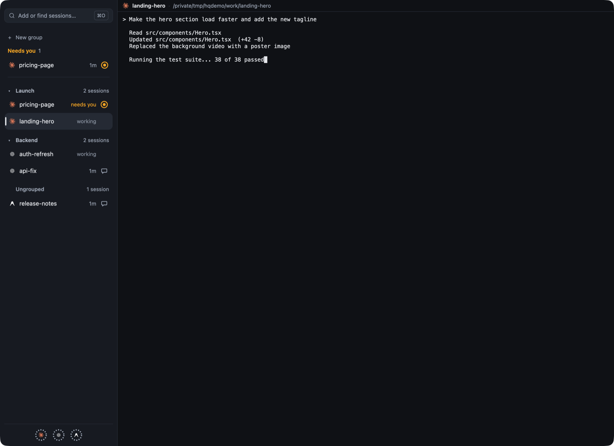

<p align="center">
  
</p>

<h1 align="center">Headquarter</h1>

<p align="center"><b>Every coding agent you run, in one place, and the one that needs you on top.</b></p>

<p align="center">
  <a href="#install">Install</a> ·
  <a href="#what-you-get">What you get</a> ·
  <a href="#how-light-is-it">How light is it</a> ·
  <a href="#settings">Settings</a> ·
  <a href="CHANGELOG.md">Changelog</a>
</p>

---

Six terminal windows. Claude Code in one, Codex in two, agy somewhere behind the
browser. One of them has been waiting for your "yes" for twenty minutes. Which one?

**Headquarter is a terminal built for coding agents.** It runs Claude Code, Codex and
Antigravity (`agy`) exactly as they run in your terminal. It keeps every session in
one sidebar and tells you, at a glance, which agents are working, which need you, and
which finished while you were away.

<table>
  <tr>
    <td></td>
    <td></td>
  </tr>
  <tr>
    <td align="center">An agent asks for permission: it goes to the top.</td>
    <td align="center">Two at work, one waiting, two done.</td>
  </tr>
</table>

<sub>Real captures of the app, with made-up sessions from a stand-in agent.</sub>

## What you get

- **One window, every session.** Each agent keeps its own interface, keys and
  questions, unchanged. Plain Ctrl keys always go to the agent.
- **Status you can trust.** Working, needs you (with the reason), done but not read
  yet, idle, and not running. It comes from the agents' own reports, not from guessing
  at the screen.
- **"Needs you" on top.** Sessions waiting for you are pinned above everything, and
  Cmd-J jumps to the next one.
- **A tap on the shoulder.** Working in another app? A notification tells you when a
  session needs you or has replied, and one click takes you straight to it.
- **Your groups, your order.** Drag sessions into groups you make; the rest sit under
  Ungrouped. Collapse it all into an icon rail when you want the room.
- **Sessions that outlive the window.** A small background host owns your sessions:
  close the app, and they keep working. After a crash, Headquarter offers to resume
  what was running.
- **Agents in other terminals, too.** Sessions you started elsewhere show up beside
  yours, marked external, so nothing hides from you.
- **Your history, one click away.** Past Claude Code, Codex and agy conversations are
  listed with their titles, ready to resume.
- **Usage at a glance.** A ring per agent shows how much of your Claude Code and Codex
  limits you have used, and when they reset.
- **Your look.** Light and dark themes, a theme creator, or paste your Alacritty
  settings and keep the look you already have.
- **Hands off your config.** Headquarter never edits your agents' configuration or
  history, and never stores your prompts or their output.

## Install

```bash
curl -fsSL https://github.com/alfonsusenrico/headquarter/releases/latest/download/install.sh | sh
```

What the installer does:

1. Picks the build for your system and checks every download against its SHA-256.
   On a mismatch it stops before changing anything.
2. Puts `hq` and `headquarter` in `~/.local/bin`, without `sudo`, and tells you how to
   add that folder to your `PATH` if it is missing.
3. On macOS, adds `Headquarter.app` to `~/Applications`, signed with a certificate the
   installer makes on your Mac and keeps in a keychain file of its own, never your login
   keychain. Open it from Spotlight or the Dock. On Linux, adds `headquarter-app` and an entry in your application menu, and
   names any system library the app still needs.

Want to read it first? Download `install.sh` from the latest release, read it, then
run `sh install.sh`. To install a particular version, set `HQ_VERSION=0.1.0`.

**Update** by running the same line again. **Uninstall** with:

```bash
curl -fsSL https://github.com/alfonsusenrico/headquarter/releases/latest/download/install.sh | sh -s -- --uninstall
```

It removes exactly what it installed, that certificate included, and keeps your
settings and sessions in
`~/.config/headquarter` and `~/.local/share/headquarter`.

**Supported:**
- macOS 13 or later, on Apple silicon and Intel.
- Linux on x86-64 and arm64, WSL included.

**About signing:** the macOS app is not signed with an Apple Developer ID yet, only with
the certificate made on your Mac. Installed with the line above, it opens without a
warning, because macOS only checks apps downloaded by a browser. If you ever see "Headquarter can't be opened", run:

```bash
xattr -dr com.apple.quarantine ~/Applications/Headquarter.app
```

Then open the app with the agents you already use: Headquarter finds Claude Code, Codex
and agy where your terminal finds them, and a short first-run setup asks which to use
and how the app should look.

## How light is it

Short answer: lighter than a terminal window per agent, once you run a few.

Measured on an Apple silicon Mac against Alacritty with one window per session, the
median of three rounds. The full numbers are in [`docs/benchmark.md`](docs/benchmark.md).

| Sessions | Headquarter memory | Alacritty memory |
|---|---|---|
| 1 working | 177 MB | 184 MB |
| 10 working | 173 MB | 1.2 GB |
| 50 working | 170 MB | 6.3 GB |

- **Memory stays flat.** Headquarter uses about the same memory for 1 session or 50.
  A window per session adds up; your RAM has better things to do.
- **CPU wins once a few agents work.** It draws only the session you are looking at,
  so ten working Claude Code sessions cost about what one does: 4.4% of a core, against
  Alacritty's 16.9%. It is ahead from three busy Claude Code or Codex sessions, and from
  ten for agy.
- **One session? Alacritty is lighter, honestly.** A single working session costs 5 to
  12% of a core here, against 3 to 12% for one Alacritty window. At idle, Headquarter
  uses under 1% of one core; Alacritty uses about none.

But you did not install a terminal for agents to run one agent.

## From the command line

Everything in the app also works from any terminal:

```bash
hq new claude                 # start Claude Code here and attach to it
hq new codex --cwd ~/app -d   # start Codex in ~/app without attaching
hq ls                         # your sidebar: sessions needing you first
hq ls --all                   # every session, including your agent history
hq attach landing-hero        # attach by name or id prefix; detach with Ctrl-\ then d
hq resume claude-1            # reopen an ended session's conversation
hq resume --interrupted       # restart the sessions a crash or restart interrupted
hq usage                      # each agent's usage and reset times
hq agents                     # the agent CLIs found on this machine
hq stop                       # end every session and the background host
```

`headquarter` is the same command under a longer name; `hq --help` lists the rest.

## Keys

| macOS | Linux | Does |
| --- | --- | --- |
| Cmd-N | Ctrl-Shift-N | Start a session |
| Cmd-O | Ctrl-Shift-O | Add sessions to the sidebar |
| Cmd-J | Ctrl-Shift-J | Show the next session that needs you |
| Cmd-1 / Cmd-2 | Ctrl-Shift-1 / 2 | Move to the sidebar / the terminal |
| Cmd-B | Ctrl-Shift-B | Switch between the sidebar and the icon rail |
| Cmd-G | Ctrl-Shift-G | Themes |
| Cmd-C / Cmd-V | Ctrl-Shift-C / V | Copy, paste |

Plain Ctrl keys always go to the agent.

## Settings

Optional: `~/.config/headquarter/config.toml`. First-run setup writes it for you, and
`headquarter-app --setup` runs setup again without touching your other settings.

```toml
[agents.codex]
path = "/opt/homebrew/bin/codex"   # use this executable

[agents.agy]
enabled = false                # hide agy

[notifications]
needs_you = true               # a session needs you
replied = false                # a session finished its turn
```

Notifications show while the app is open and you are not already looking at that
session. On macOS they need the installed `Headquarter.app`, and macOS asks once for
permission.

The app reads its look and keys with Alacritty's names, so you can paste your
Alacritty settings in:

```toml
[general]
import = ["~/.config/alacritty/themes/catppuccin_mocha.toml"]   # colours only

[window]
opacity = 0.7
blur = true
decorations = "Buttonless"     # Full, Buttonless, or None
option_as_alt = "Both"

[font]
size = 14
normal = { family = "JetBrainsMono Nerd Font", style = "Medium" }

[[keyboard.bindings]]
key = "Return"
mods = "Shift"
chars = "\u001B\r"            # Shift+Enter for a new line in Claude Code
```

Mistakes are reported with the file and line, Alacritty settings Headquarter does not
offer are named rather than ignored, and changes apply without a restart.

## Building from source

Rust via rustup (the version is pinned in `rust-toolchain.toml`) and the OpenSpec CLI
for spec checks.

```bash
cargo build --release          # target/release/hq, headquarter and headquarter-app
./scripts/check                # format, lint, tests, dependency policy, specs
```

Plan for about 4 GB in `target/`. On macOS the default build compiles its shaders at
startup, so Xcode is not needed. On Linux, install the windowing and font headers first
(Debian and Ubuntu names):

```bash
sudo apt-get install libxkbcommon-dev libxkbcommon-x11-dev libwayland-dev libxcb1-dev \
  libx11-xcb-dev libfontconfig-dev libfreetype-dev libvulkan-dev
```

## Roadmap

- A signed and notarized macOS app.

## Licence

MIT or Apache-2.0, at your option ([LICENSE-MIT](LICENSE-MIT),
[LICENSE-APACHE](LICENSE-APACHE)). The bundled theme templates keep their own
licences: [`crates/hq-app/themes/NOTICE.md`](crates/hq-app/themes/NOTICE.md).
